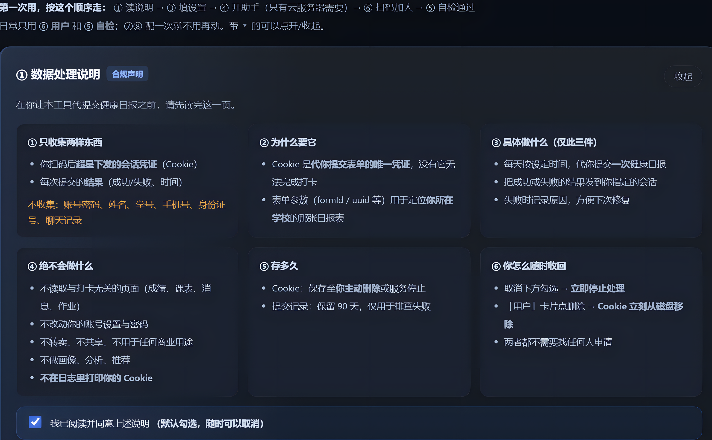
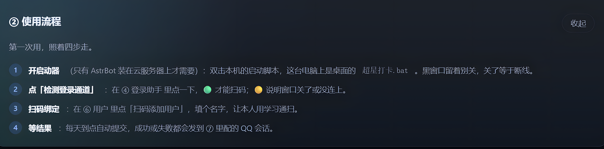
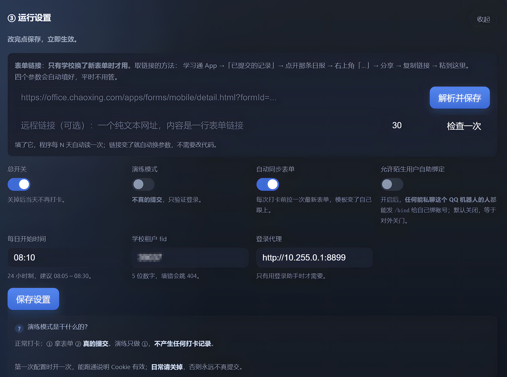
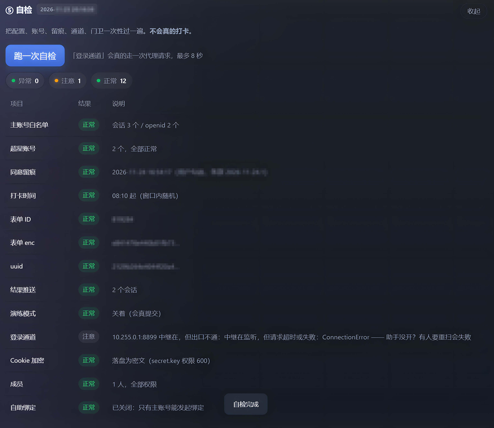
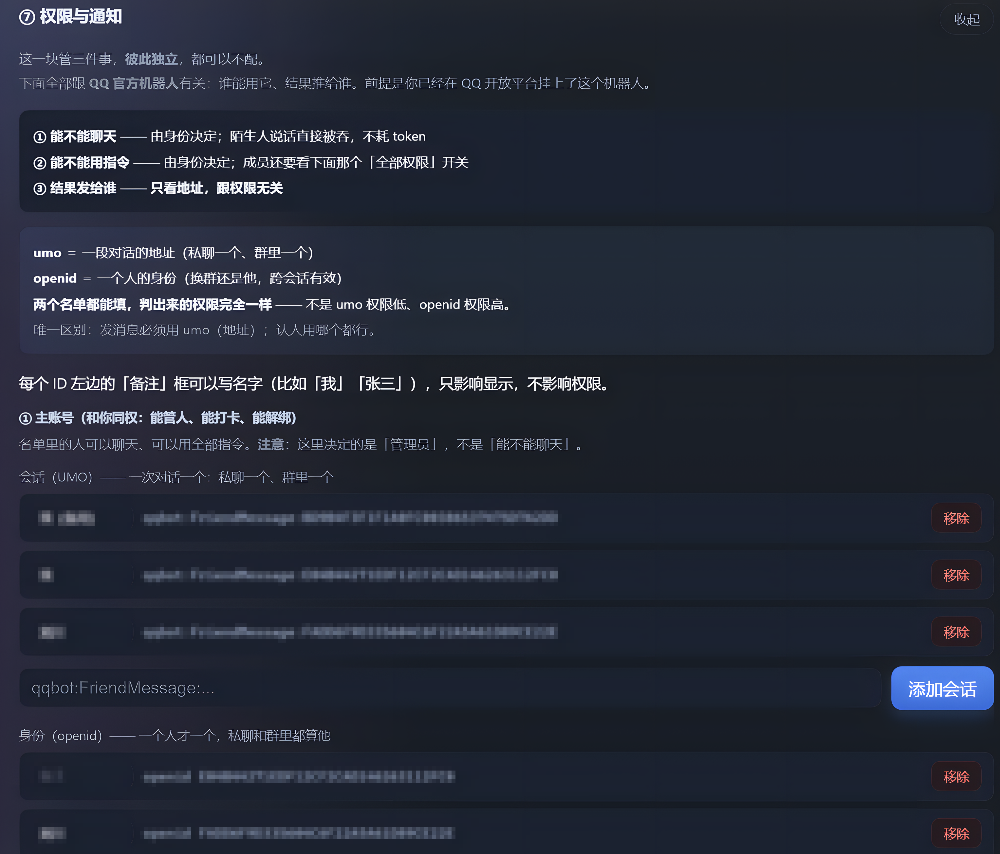
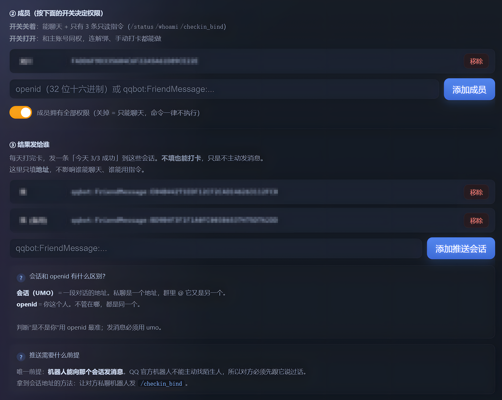

# 健康日报自动填写助手（AstrBot 插件 + CLI）

在**你的本地终端或云服务器**上运行，按**你提供的表单链接**，在设定的时间窗口内自动填写并提交健康日报，结果可推送到 QQ。支持多账号、扫码登录、随机延迟、失败分类与告警。

> **它不内置任何平台凭据，也不修改平台的安全校验。**
> - 只用扫码登录后得到的会话状态
> - 只访问你填进去的那张表单
> - 不采集、不上传、不共享任何人的数据（见 [隐私说明](docs/PRIVACY.md)）
> - 提交内容是否真实、准确，由本人负责
>
> 使用前请确认符合你所在学校的规定；因使用产生的后果由使用者承担。

> **兼容性**：适配常见高校「健康日报」类表单（含 XUEXITONG 类表单）。仓库**不附带任何学校的真实参数**，参数需按 [参数获取说明](docs/HOWTO-CAPTURE.md) 自行获取。

> ⚠️ **本项目完全免费开源。** 任何在闲鱼、淘宝等平台收费售卖的，均非作者授权；请直接使用本仓库或 AstrBot 插件市场。

---

## 界面一览

> 截图取自作者自己的实例，账号、UID、openid、服务器地址均已打码。

**① 数据处理说明** —— 收集什么、不收集什么、存多久、怎么撤回



**② 使用流程** —— 第一次用照四步走，云端与本机都覆盖



**③ 运行设置** —— 表单链接、远程链接、开关、时间



**④ 登录助手** —— 只有 AstrBot 装在云服务器时才需要


**⑤ 自检** —— 配置、账号、留痕、通道、门卫一次过一遍



**⑥ 门卫矩阵** —— 谁 × 哪条命令，和代码里是同一份判定


**⑦ 用户** —— 每人一份独立状态，四个操作按钮


**⑧ 权限与通知** —— 谁能用、结果发给谁，彼此独立



**⑨ 成员与推送** —— 成员权限开关、推送会话列表



---

## 功能

| 能力 | 说明 |
|---|---|
| **多账号** | 一个机器人管若干个同学，每人一份独立状态，互不干扰 |
| **扫码绑定** | 学习通 App 扫一扫即可，不用手动抓 Cookie |
| **幂等** | 同一天重复运行会自动跳过，不会重复提交 |
| **随机时间** | 所有账号随机铺在指定时间窗口内，避免同一秒集中请求 |
| **失败重试** | 失败后自动再试一次 |
| **开机补跑** | 电脑休眠错过时间，启动后自动补一次 |
| **结果推送** | 发到指定 QQ 会话；不配推送也能正常打卡 |
| **权限门卫** | 判定收敛到 `policy.py`：主账号 / 已绑定同学 / 陌生人三种身份，其他人只认 3 条指令 |
| **状态自检** | 面板点一下，把配置、账号、留痕、通道、门卫矩阵全过一遍，不真打卡 |
| **操作留痕** | 同意、改配置、增删用户、手动打卡写进 `audit.jsonl`（600 权限，512 KB 轮转） |

---

## 文档

| 文档 | 讲什么 |
|---|---|
| [docs/DEPLOY.md](docs/DEPLOY.md) | **部署与接入**：三层结构、三条路线、QQ 接线、排查表 |
| [docs/HOWTO-CAPTURE.md](docs/HOWTO-CAPTURE.md) | 参数获取说明（三条路，含参数对照表） |
| [CREDITS.md](CREDITS.md) | 参考过的开源项目与许可证 |
| [docs/PRIVACY.md](docs/PRIVACY.md) | 收集什么、存在哪、怎么删 |
| [docs/DISCLAIMER.md](docs/DISCLAIMER.md) | 使用边界、风险、免责 |
| [docs/AUDIT-AND-GATE.md](docs/AUDIT-AND-GATE.md) | 权限判定与操作留痕的实现说明 |

---

## 它是怎么跑起来的

```text
QQ 客户端 / 协议端  ──消息──▶  AstrBot  ──调用──▶  本插件
（收发 QQ 消息）              （大脑：路由 + 面板）    （技能：取表单、提交、记状态）
```

**AstrBot 自己不会登录 QQ**，它需要一个消息平台适配器；本插件只是它的一个技能，不碰 QQ 协议。

### 先选路线，别一上来就装全套

| 路线 | 适合谁 | 耗时 | 要 QQ 机器人吗 | 实测状态 |
|---|---|---|---|---|
| **A. 命令行 + Webhook** | 只给自己打卡 | **10 分钟** | **不要**（结果推微信） | 已实测 |
| **B. AstrBot + QQ 官方机器人** | 想在 QQ 里收结果、用指令 | 30–60 分钟 | 要（官方） | 已实测 |
| **C. AstrBot + OneBot 协议端** | 想要完整私聊/群聊体验 | 1–2 小时 | 要（第三方） | **未实测** |

**推荐顺序：A → B。C 不推荐新手。**

> **C 的说明**：接线方向、端口、URL 都核对过 AstrBot 官方文档，但作者**没有真的搭一套协议端跑通**。
> 文档是对的，实操可能有坑；而且第三方协议端非腾讯官方实现，登录的 QQ 号有被限制的风险。
> **想在 QQ 里用，请走 B。**
>
> 三条路线的完整步骤、端口、排查表见 **[docs/DEPLOY.md](docs/DEPLOY.md)**。

---

## 快速开始（路线 A：10 分钟，不用机器人）

**只给自己打卡的话，这条最省事**：不装 AstrBot、不装 Docker、不碰 QQ，结果推到微信。

### A1. 装 Python 和依赖

```bash
# Windows：去 python.org 装 3.8+，安装时勾上 Add to PATH
# macOS/Linux：一般自带 python3
python --version

git clone https://github.com/SuguSTheCreator/astrbot_plugin_xuexit_checkin.git
cd astrbot_plugin_xuexit_checkin
pip install -r requirements.txt
```

### A2. 拿表单链接

```text
学习通 App →「已提交的记录」→ 点开那条日报
→ 右上角「…」→ 分享 → 复制链接
→ 发到电脑（微信文件传输助手就行）
```

> **必须已经手动填过一次**，否则没有历史记录，自动同步拿不到模板。

### A3. 一条命令抠出四个参数

```bash
python standalone/cli.py --parse-url "粘贴那条链接" --out config.local.json
```

输出会列出 `form_id` / `enc` / `fid_enc` / `state_fid`，并写进配置。
缺哪个会直接告诉你（通常是复制成列表页而不是详情页）。

### A4. 扫码登录，不用手抄 Cookie

```bash
python standalone/cli.py --login --fid 你的学校fid --out config.local.json
```

```text
二维码存成 qr.png → 打开它 → 学习通 App 扫 → 手机上点确认
命令会自动把 Cookie 写进同一个配置文件
```

> `fid` 就是上一步解析出的 `state_fid`。
> 云服务器上这一步可能失败（出口 IP 过不了登录环境校验），换本机跑，或见 [helper/README.md](helper/README.md)。

### A5. 补两项，然后验证

编辑 `config.local.json`，补上：

```json
{
  "location": "纬度,经度,地址",
  "webhook_url": "https://sctapi.ftqq.com/<你的SENDKEY>.send"
}
```

- `location`：地图右键取坐标，格式 `纬度,经度,地址`
- `webhook_url`：Server酱 / PushPlus 推微信，Bark 推 iPhone；不填就不推送

```bash
python standalone/cli.py --config config.local.json --dry-run
```

看到 `dry-run 通过` 就说明 Cookie 和参数都对了。**演练不产生任何打卡记录。**

### A6. 真跑一次，然后挂定时

```bash
python standalone/cli.py --config config.local.json
```

Linux / macOS crontab：

```cron
5 8 * * *  cd /path/to/repo && python3 standalone/cli.py --config config.local.json >> run.log 2>&1
40 8 * * * cd /path/to/repo && python3 standalone/cli.py --config config.local.json >> run.log 2>&1
```

Windows：任务计划程序 → 新建基本任务 → 每天 08:05 → 程序填 `python`，
参数填 `standalone/cli.py --config config.local.json`，起始于填仓库目录。

第二条是兜底：已提交的会自动跳过，不会重复提交。

**到这里就完事了。** 想加人见「用法二：命令行」的多账号模式。

---

## 快速开始（路线 B：AstrBot + QQ 机器人）

> 全程约 30–60 分钟。Docker 起 AstrBot → 面板装插件 → 接 QQ → 贴表单链接 → 扫码。

### 0. 先确认你有这些

| 需要 | 说明 |
|---|---|
| 一台常开机的机器 | 家里电脑 / 云服务器都行。关机 = 当天不打卡 |
| AstrBot | 下一步一行命令装好 |
| 一个 QQ 机器人 | 第 3 步，这一步最费劲 |
| 表单链接 | 学习通 App →「已提交的记录」→ 点开那条日报 → 右上角「…」→ 分享 → 复制链接 |

### 1. 装 AstrBot

```bash
docker run -d --name astrbot -p 6185:6185 \
  -v ~/astrbot/data:/AstrBot/data \
  soulter/astrbot:latest
```

打开 `http://你的IP:6185`，默认账号 `astrbot` / `astrbot`，**第一件事是改密码**。

> 不用 Docker：去 AstrBot 仓库下 Windows 版压缩包，解压双击启动，效果一样。

### 2. 装本插件

```text
面板 → 插件市场 → 搜索「健康日报自动填写」→ 安装 → 重载插件
```

装不上就手动放：把本仓库整个文件夹扔进 `AstrBot/data/plugins/`，重启 AstrBot。

### 3. 接 QQ（唯一麻烦的一步）

两条路，选一条：

**A. QQ 官方机器人**（AstrBot 官方推荐，更稳定）

```text
1. AstrBot WebUI → 左边栏「机器人」→「+ 创建机器人」
2. 选「QQ 官方机器人（WebSocket）」
3. 创建方式选「扫码一键创建」→ 用手机 QQ 扫码确认
   AstrBot 会自动填入 AppID / AppSecret，不用自己去开放平台申请
4. 回到 QQ 开放平台，点机器人右边的「扫码聊天」，用手机 QQ 扫码即可对话
```

> 扫码不可用时才走「手动创建」：去 [bot.q.qq.com](https://bot.q.qq.com) 创建机器人、
> 在「开发 → 开发设置」拿 appid / secret，并把服务器 IP 加进白名单。
>
> **让别人加这个机器人**：机器人搜不到，要先在开放平台「开发体验号码设置」里
> 把对方 QQ 号加进内测名单（**上限 20 人**），再用你的 QQ 把机器人「私聊推荐」给他，
> 他才能加好友。完整流程与截图见 [docs/DEPLOY.md](docs/DEPLOY.md) 第 4.3 节。
>
> **群聊**：在机器人资料页点「添加到群聊」（目前只能加自己为群主的群），
> 并在群设置里打开「获取群内全部消息」和「机器人主动在群聊内发言」。

**B. OneBot v11 协议端**（NapCat 等）

**方向是反的：AstrBot 做服务端，协议端主动连过来。**

```text
1. AstrBot WebUI → 机器人 → 创建机器人 → OneBot v11
     反向 WebSocket 主机 0.0.0.0，端口 6199（默认）
2. 协议端（如 NapCat）→ 网络配置 → 新建 → WebSockets 客户端
     URL 填 ws://127.0.0.1:6199/ws
3. AstrBot → 数据与日志 → 日志，出现「适配器已连接」即成功
```

> 完整步骤、Docker 网络写法、端口说明见 [docs/DEPLOY.md](docs/DEPLOY.md) 第 5 节。
>
> ⚠️ 第三方协议端不是腾讯官方实现，用它登录的 QQ 号有被限制的风险：
> **请用专门的备用号，不要挂主号**；也不要在公网暴露协议端端口。

> **只想打卡、不想要机器人？** 用下面的「用法二：命令行」+ Webhook，完全不碰 QQ。

### 4. 填表单参数

```text
面板 → ③ 运行设置 → 粘贴表单链接 → 「解析并保存」
再设：每日开始时间（默认 08:10）、总开关
```

### 5. 绑定账号

```text
⑥ 用户 → 「扫码添加用户」→ 填个名字 → 本人用学习通 App 扫
```

> 云服务器部署：扫码会被平台拦住，需要先开「④ 登录助手」（见「登录助手」一节）。

### 6. 自检

```text
⑤ 自检 → 点「跑一次自检」
全绿 = 可以了
「登录通道」黄色只影响扫码，不影响已经绑好的账号
```

### 7. 把自己设成主账号

机器人默认谁都不认，得先告诉它「你是我」。

```text
1. 用你的 QQ 私聊机器人，发：/checkin_bind
2. 它回一串会话标识（UMO），形如 qqbot:FriendMessage:XXXX
3. 复制 → 面板「⑦ 权限与通知」→「主账号 / 会话」→ 添加
```

> 也可以用 `/whoami` 拿 openid 填到「主账号 / openid」——换群、换私聊都认得你。
> 两个名单都空时插件处于「开放模式」，谁都能用全部命令，自检会标红。

### 8. 加同学（可选）

```text
⑥ 用户 → 扫码添加用户 → 让本人扫
⑦ 权限与通知 → 把他的 openid / UMO 加进「成员」，决定他能不能用指令
③ 结果发给谁 → 填他的会话地址，他才能收到自己的结果
```

> 默认 `ALLOW_SELF_BIND` 关闭，陌生人不能自己绑定。

---

## 安装与升级

三种安装方式，**升级方式各不相同**，按你当初怎么装的选：

| 当初怎么装的 | 怎么升级 | 说明 |
|---|---|---|
| **插件市场** | 面板 → 插件市场 → 该插件「更新」 | 只有我们 bump 了版本号，面板才提示有更新 |
| **上传 ZIP** | 下载新 Release 的 zip → 面板上传替换 | 不用装 git，见下方下载地址 |
| **git clone / 手动放目录** | `git pull` → 重启 AstrBot | 手动放的目录没有 git，就重新下载 zip 覆盖 |

### 运行包下载（不含截图与测试，约 0.12 MB）

```text
https://github.com/SuguSTheCreator/astrbot_plugin_xuexit_checkin/releases/latest
```

每个 Release 都附一个 `astrbot_plugin_xuexit_checkin-v<版本>.zip`，
里面只有跑起来需要的文件（源码 + 面板 + 配置模板 + 文档）。

> 仓库本体因为带截图会大一些；**运行包已经把截图、测试、开发配置排除**，
> 所以体积远小于 AstrBot 插件市场的 16 MB 上限。

### 升级会不会丢配置

不会。配置、账号、状态、留痕都在 AstrBot 的数据目录里，不在插件目录：

```text
data/config/astrbot_plugin_xuexit_checkin_config.json   ← 配置
data/plugin_data/astrbot_plugin_xuexit_checkin/         ← 账号 / 状态 / 留痕 / 密钥
```

覆盖插件目录不动这两处。**但备份时记得连 `secret.key` 一起备**，
少了它，加密的 Cookie 还原不出来（只能重新扫码）。

#### 配置键改名的情况

新增配置项由 AstrBot 按 schema 自动补默认值；**改过名的旧键**由插件自己搬运
（`config_migrate.py`），启动时执行一次并记进留痕，不会让你填过的值静默失效。

---

## 两种用法

### 用法一：AstrBot 插件（推荐）

```text
1. AstrBot 面板 → 插件市场 → 搜索「健康日报自动填写」→ 安装
2. 重载插件
3. 面板左侧「扩展功能」→「健康日报设置」→ 按页面提示操作
```

### 用法二：命令行（无机器人也能跑）

```bash
pip install requests

# 单账号
python standalone/cli.py --config config.local.json

# 多账号
python standalone/cli.py --accounts accounts.json --state-dir state/

# 只检查不提交
python standalone/cli.py --config config.local.json --dry-run
```

配好 crontab：

```cron
5 8 * * *  cd /opt/xuexit && python3 standalone/cli.py --accounts accounts.json --state-dir state >> run.log 2>&1
40 8 * * * cd /opt/xuexit && python3 standalone/cli.py --accounts accounts.json --state-dir state >> run.log 2>&1
```

第二条是兜底：已提交的会自动跳过。

**把结果推到微信**：在配置里填 `webhook_url`，支持 Server酱 / PushPlus / Bark / 自定义 URL。

```json
{ "webhook_url": "https://sctapi.ftqq.com/<你的SENDKEY>.send" }
```

这条路线**不需要 AstrBot、不需要 QQ 机器人**，10 分钟能配完。详见 [docs/DEPLOY.md](docs/DEPLOY.md) 第 3 节。

---

## 配置

把 `config.example.json` 复制成 `config.local.json`，填这几项：

| 字段 | 说明 |
|---|---|
| `cookie` | 登录超星后的 Cookie（等于账号密码，**绝不要提交**） |
| `form_id` / `enc` / `fid_enc` / `state_fid` | 表单与学校参数 |
| `uuid` / `submit_version` | 表单实例参数 |
| `form_template` | `formIdValueData` 原文 |
| `location` | 定位，格式 `纬度,经度,地址` |

### 换成你自己的学校

完整步骤见 **[docs/HOWTO-CAPTURE.md](docs/HOWTO-CAPTURE.md)**，最快 2 分钟：

1. 学习通 App →「已提交的记录」→ 点开那条日报 → 右上角「…」→ 分享 → 复制链接；
2. 面板「③ 运行设置」→ 粘贴链接 →「解析并保存」，四个参数自动填好；
3. 「⑥ 用户」→ 扫码添加用户（登录状态自动加密保存，**不用手抄 Cookie**）；
4. 打开「演练模式」→ 点「试跑」验证，通过后关掉演练模式。

> 只有**命令行模式**（没有面板）才需要自己填 `cookie` 字段。

`uuid` / `submit_version` / `form_template` 可以留空——开着「自动同步表单」时会自己取。

---

## 登录助手（仅云服务器需要）

数据中心（云服务器）的出口 IP 通常无法通过平台对登录环境的常规校验，因此**装在云服务器上的 AstrBot 可能打不开登录页**，生成不了二维码。

解决办法：在你自己的电脑上运行「登录助手」，临时把家庭宽带借给服务器用一次。

```text
1. 下载 helper 目录
2. 复制 helper.example.json 为 helper.json，把 server 改成 root@你的服务器IP
3. Windows 双击 `start-helper.bat`；macOS 执行 `start-helper.sh`
4. 复制窗口里打印的公钥 → AstrBot 面板「登录助手 → 公钥」→ 提交
5. 面板点「检测登录通道」→ 显示 🟢 后即可扫码
6. 用完关窗口，隧道立即断开
```

细节见 [helper/README.md](helper/README.md)。

> AstrBot 装在自己电脑上的用户**完全不需要**这一步。

---

## 命令

判定只有一处实现：`policy.py` 的 `identity()` + `gate()`，面板「门卫矩阵」展示的就是它的输出。

| 命令 | 主账号 | 成员 | 陌生人 |
|---|---|---|---|
| `/status` 查看自己的绑定状态 | ✅ | ✅ | ✅ |
| `/whoami` 打印 umo / openid | ✅ | ✅ | ✅ |
| `/checkin_bind` 打印当前会话标识 | ✅ | ✅ | ✅ |
| `/bind` 扫码绑定自己的账号 | ✅ | 开关决定 | 开关决定 |
| `/login 名字` 为指定账号生成二维码 | ✅ | 开关决定 | ❌ |
| `/checkin` 立刻补打一次 | ✅ | 开关决定 | ❌ |
| `/unbind 名字` 解绑 | ✅ | 开关决定 | ❌ |
| 普通聊天 | ✅ | 开关决定 | ❌（直接丢弃） |

两个开关：

- **`ALLOW_SELF_BIND`（默认关闭）**：关闭时 `/bind` 只有主账号能用，等于对外关门。
- **`MEMBER_ALL`（成员全部权限）**：打开时成员与主账号同权；关闭时成员只剩上面三条只读指令。

> 「成员」= 面板「⑦ 权限与通知」里手工加入名单的人（openid 或会话都可以）。
> 不在任何名单里的人一律按陌生人处理。

---

## 常见问题

**Q：同学需要做什么？**
加机器人为好友 → 发 `/bind` → 扫一下 → 手机上点确认。之后什么都不用做。

**Q：Cookie 多久过期？**
几天到几周。过期后打卡失败，插件会标记并通知主账号，让本人重新扫一次即可。

**Q：会不会重复提交？**
不会。每人一份「今天已提交」记录，同一天再跑自动跳过。

**Q：一定要有 QQ 机器人吗？**
不需要。没有机器人也能打卡，只是结果不会推送，可在面板或日志里看。

**Q：演练模式是什么？**
只验证登录和表单，**不真的提交**。第一次配置时用来确认 Cookie 有效。

---

## 隐私

完整的收集范围、保留期限与删除方式见 **[docs/PRIVACY.md](docs/PRIVACY.md)**。


- 服务器地址、Cookie 只写在本地配置里，**不要提交到仓库**；
- `config.local.json`、`accounts.json`、`state/`、`.secrets/` 已在 `.gitignore`；
- Cookie 等同于账号密码，泄露即失守；删除用户时请一并清理；
- 登录助手只允许访问超星域名，不做通用代理。

---

## 免责声明

本项目仅供个人学习与自动化实践。使用前请确认符合所在学校的规定与超星用户协议，**使用后果自负**。
本项目不收集、不上传任何用户数据。

---

## 协议

**AGPL-3.0-or-later** —— 与 AstrBot 本体保持一致。

这意味着：你可以自由使用、修改、分发；但如果把它部署成公开的在线服务，需要开源你修改的部分。

详见 [LICENSE](LICENSE)。