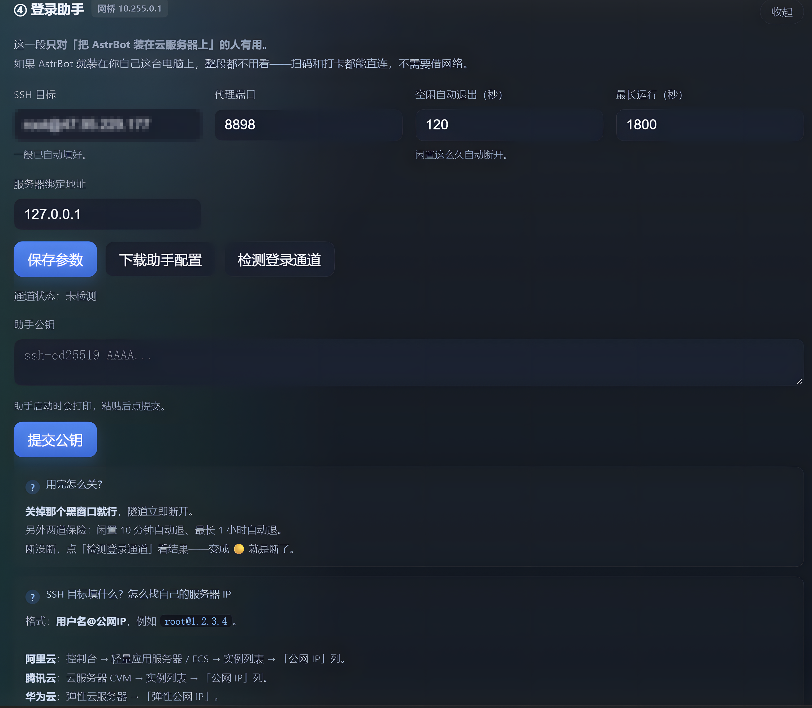
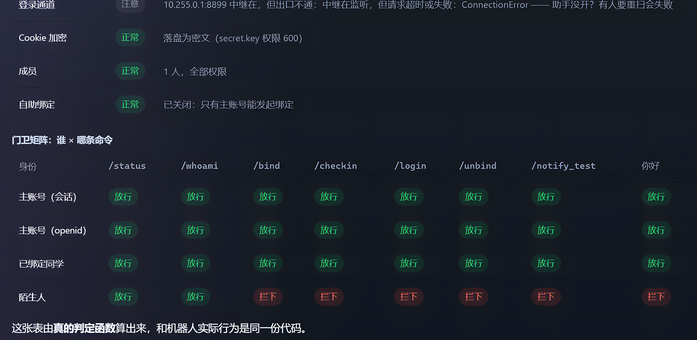
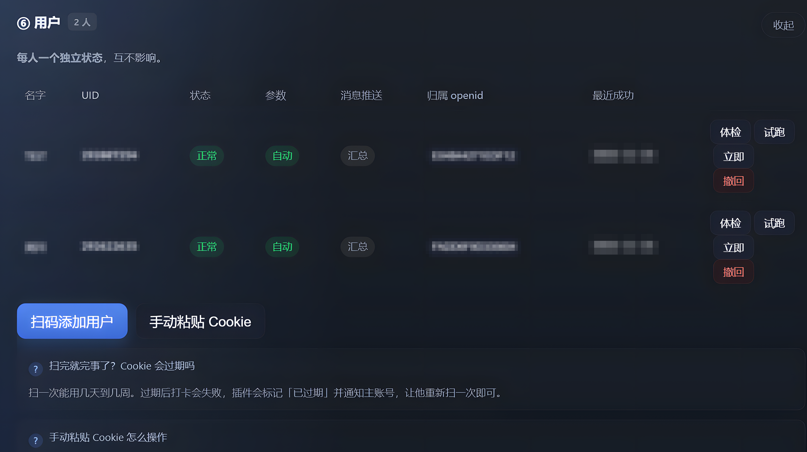

# 健康日报自动填写助手（AstrBot 插件 + CLI）

在**你的本地终端或云服务器**上运行，按**你提供的表单链接**，在设定的时间窗口内自动填写并提交健康日报，结果可推送到 QQ。支持多账号、扫码登录、随机延迟、失败分类与告警。

> **它不内置任何平台凭据，也不修改平台的安全校验。**
> - 只用扫码登录后得到的会话状态
> - 只访问你填进去的那张表单
> - 不采集、不上传、不共享任何人的数据（见 [隐私说明](docs/PRIVACY.md)）
> - 提交内容是否真实、准确，由本人负责
>
> 使用前请确认符合你所在学校的规定；因使用产生的后果由使用者承担。

> **兼容性**：适配常见高校「健康日报」类表单（含 XUEXITONG 类表单）。仓库**不附带任何学校的真实参数**，参数需按 [抓包说明](docs/HOWTO-CAPTURE.md) 自行获取。

> ⚠️ **本项目完全免费开源。** 任何在闲鱼、淘宝等平台收费售卖的，均非作者授权；请直接使用本仓库或 AstrBot 插件市场。

---

## 界面一览

> 截图取自作者自己的实例，账号、UID、openid、服务器地址均已打码。

**① 数据处理说明** —— 收集什么、不收集什么、存多久、怎么撤回


**② 使用流程** —— 第一次用照四步走，云端与本机都覆盖


**③ 运行设置** —— 表单链接、远程链接、开关、时间


**④ 登录助手** —— 只有 AstrBot 装在云服务器时才需要



**⑤ 自检** —— 配置、账号、留痕、通道、门卫一次过一遍


**⑥ 门卫矩阵** —— 谁 × 哪条命令，和代码里是同一份判定



**⑦ 用户** —— 每人一份独立状态，四个操作按钮



**⑧ 权限与通知** —— 谁能用、结果发给谁，彼此独立


**⑨ 成员与推送** —— 成员权限开关、推送会话列表


---

## 功能

| 能力 | 说明 |
|---|---|
| **多账号** | 一个机器人管若干个同学，每人一份独立状态，互不干扰 |
| **扫码绑定** | 学习通 App 扫一扫即可，不用手动抓 Cookie |
| **幂等** | 同一天重复运行会自动跳过，不会重复提交 |
| **随机时间** | 所有账号随机铺在指定时间窗口内，避免同一秒集中请求 |
| **失败重试** | 失败后自动再试一次 |
| **开机补跑** | 电脑休眠错过时间，启动后自动补一次 |
| **结果推送** | 发到指定 QQ 会话；不配推送也能正常打卡 |
| **权限门卫** | 判定收敛到 `policy.py`：主账号 / 已绑定同学 / 陌生人三种身份，其他人只认 3 条指令 |
| **状态自检** | 面板点一下，把配置、账号、留痕、通道、门卫矩阵全过一遍，不真打卡 |
| **操作留痕** | 同意、改配置、增删用户、手动打卡写进 `audit.jsonl`（600 权限，512 KB 轮转） |

---

## 文档

| 文档 | 讲什么 |
|---|---|
| [docs/HOWTO-CAPTURE.md](docs/HOWTO-CAPTURE.md) | 换成自己学校的参数怎么拿（四条路，难度从低到高） |
| [docs/PRIVACY.md](docs/PRIVACY.md) | 收集什么、存在哪、怎么删 |
| [docs/DISCLAIMER.md](docs/DISCLAIMER.md) | 使用边界、风险、免责 |
| [docs/AUDIT-AND-GATE.md](docs/AUDIT-AND-GATE.md) | 权限判定与操作留痕的实现说明 |

---

## 快速开始

> 全程约 10–20 分钟。最短路径：Docker 起 AstrBot → 面板装插件 → 接 QQ → 贴表单链接 → 扫码。

### 0. 先确认你有这些

| 需要 | 说明 |
|---|---|
| 一台常开机的机器 | 家里电脑 / 云服务器都行。关机 = 当天不打卡 |
| AstrBot | 下一步一行命令装好 |
| 一个 QQ 机器人 | 第 3 步，这一步最费劲 |
| 表单链接 | 学习通 App →「已提交的记录」→ 点开那条日报 → 右上角「…」→ 分享 → 复制链接 |

### 1. 装 AstrBot

```bash
docker run -d --name astrbot -p 6185:6185 \
  -v ~/astrbot/data:/AstrBot/data \
  soulter/astrbot:latest
```

打开 `http://你的IP:6185`，默认账号 `astrbot` / `astrbot`，**第一件事是改密码**。

> 不用 Docker：去 AstrBot 仓库下 Windows 版压缩包，解压双击启动，效果一样。

### 2. 装本插件

```text
面板 → 插件市场 → 搜索「健康日报自动填写」→ 安装 → 重载插件
```

装不上就手动放：把本仓库整个文件夹扔进 `AstrBot/data/plugins/`，重启 AstrBot。

### 3. 接 QQ（唯一麻烦的一步）

两条路，选一条：

**A. QQ 官方机器人**（推荐，稳定）

```text
1. q.qq.com 开放平台建一个机器人，拿到 AppID / AppSecret
2. AstrBot 面板 → 配置 → 消息平台 → 选 qq_official
3. 填 AppID / AppSecret，保存并重启
4. 在 QQ 里私聊这个机器人发一句话，能收到回复就算通了
```

**B. OneBot 协议端**（NapCat / LLOneBot 等）

```text
1. 本机跑一个 QQ 客户端 + 协议端，开 WebSocket，端口 3001
2. AstrBot → 消息平台 → 选 aiocqhttp → ws://127.0.0.1:3001
```

> **只想打卡、不想要机器人？** 直接用下面的「用法二：命令行」，完全不碰 QQ。

### 4. 填表单参数

```text
面板 → ③ 运行设置 → 粘贴表单链接 → 「解析并保存」
再设：每日开始时间（默认 08:10）、总开关
```

### 5. 绑定账号

```text
⑥ 用户 → 「扫码添加用户」→ 填个名字 → 本人用学习通 App 扫
```

> 云服务器部署：扫码会被平台拦住，需要先开「④ 登录助手」（见「登录助手」一节）。

### 6. 自检

```text
⑤ 自检 → 点「跑一次自检」
全绿 = 可以了
「登录通道」黄色只影响扫码，不影响已经绑好的账号
```

### 7. 加同学（可选）

```text
⑥ 用户 → 扫码添加用户 → 让本人扫
⑦ 权限与通知 → 决定他能不能用指令、结果推给谁
```

---

## 两种用法

### 用法一：AstrBot 插件（推荐）

```text
1. AstrBot 面板 → 插件市场 → 搜索「健康日报自动填写」→ 安装
2. 重载插件
3. 面板左侧「扩展功能」→「超星打卡设置」→ 按页面提示操作
```

### 用法二：命令行（无机器人也能跑）

```bash
pip install requests

# 单账号
python standalone/cli.py --config config.local.json

# 多账号
python standalone/cli.py --accounts accounts.json --state-dir state/

# 只检查不提交
python standalone/cli.py --config config.local.json --dry-run
```

配好 crontab：

```cron
5 8 * * *  cd /opt/xuexit && python3 standalone/cli.py --accounts accounts.json --state-dir state >> run.log 2>&1
40 8 * * * cd /opt/xuexit && python3 standalone/cli.py --accounts accounts.json --state-dir state >> run.log 2>&1
```

第二条是兜底：已提交的会自动跳过。

---

## 配置

把 `config.example.json` 复制成 `config.local.json`，填这几项：

| 字段 | 说明 |
|---|---|
| `cookie` | 登录超星后的 Cookie（等于账号密码，**绝不要提交**） |
| `form_id` / `enc` / `fid_enc` / `state_fid` | 表单与学校参数 |
| `uuid` / `submit_version` | 表单实例参数 |
| `form_template` | `formIdValueData` 原文 |
| `location` | 定位，格式 `纬度,经度,地址` |

### 换成你自己的学校

完整步骤见 **[docs/HOWTO-CAPTURE.md](docs/HOWTO-CAPTURE.md)**，最快 2 分钟：

1. 打开表单填写页，**地址栏**里就有 `formId` / `enc` / `fidEnc` / `stateFid`；
2. F12 → Network → 随便点一个请求 → 复制 `Cookie` 整行；
3. 填进配置，先跑一次 `--dry-run` 验证。

`uuid` / `submit_version` / `form_template` 可以留空——开着「自动同步表单」时会自己取。

---

## 登录助手（仅云服务器需要）

超星会拦截机房 IP，所以**装在云服务器上的 AstrBot 打不开登录页**，生成不了二维码。

解决办法：在你自己的电脑上运行「登录助手」，临时把家庭宽带借给服务器用一次。

```text
1. 下载 helper 目录
2. 复制 helper.example.json 为 helper.json，把 server 改成 root@你的服务器IP
3. Windows 双击 `start-helper.bat`；macOS 执行 `start-helper.sh`
4. 复制窗口里打印的公钥 → AstrBot 面板「登录助手 → 公钥」→ 提交
5. 面板点「检测登录通道」→ 显示 🟢 后即可扫码
6. 用完关窗口，隧道立即断开
```

细节见 [helper/README.md](helper/README.md)。

> AstrBot 装在自己电脑上的用户**完全不需要**这一步。

---

## 命令

| 命令 | 谁能用 | 作用 |
|---|---|---|
| `/bind` | 所有人 | 扫码绑定自己的超星账号 |
| `/status` | 所有人 | 查看自己的绑定状态 |
| `/checkin_bind` | 所有人 | 打印当前会话标识（拿 UMO 用） |
| `/whoami` | 所有人 | 打印 umo / openid，用于配主账号 |
| `/login 名字` | 主账号 | 代某个同学生成二维码 |
| `/checkin` | 主账号 | 立刻补打一次 |
| `/unbind 名字` | 主账号 | 解绑 |

---

## 常见问题

**Q：同学需要做什么？**
加机器人为好友 → 发 `/bind` → 扫一下 → 手机上点确认。之后什么都不用做。

**Q：Cookie 多久过期？**
几天到几周。过期后打卡失败，插件会标记并通知主账号，让本人重新扫一次即可。

**Q：会不会重复提交？**
不会。每人一份「今天已提交」记录，同一天再跑自动跳过。

**Q：一定要有 QQ 机器人吗？**
不需要。没有机器人也能打卡，只是结果不会推送，可在面板或日志里看。

**Q：演练模式是什么？**
只验证登录和表单，**不真的提交**。第一次配置时用来确认 Cookie 有效。

---

## 隐私

完整的收集范围、保留期限与删除方式见 **[docs/PRIVACY.md](docs/PRIVACY.md)**。


- 服务器地址、Cookie 只写在本地配置里，**不要提交到仓库**；
- `config.local.json`、`accounts.json`、`state/`、`.secrets/` 已在 `.gitignore`；
- Cookie 等同于账号密码，泄露即失守；删除用户时请一并清理；
- 登录助手只允许访问超星域名，不做通用代理。

---

## 免责声明

本项目仅供个人学习与自动化实践。使用前请确认符合所在学校的规定与超星用户协议，**使用后果自负**。
本项目不收集、不上传任何用户数据。

---

## 协议

**AGPL-3.0-or-later** —— 与 AstrBot 本体保持一致。

这意味着：你可以自由使用、修改、分发；但如果把它部署成公开的在线服务，需要开源你修改的部分。

详见 [LICENSE](LICENSE)。