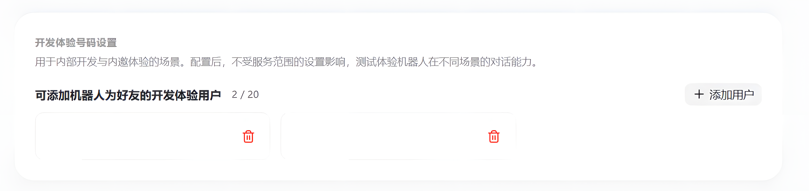

# 部署与接入

这份文档讲清楚**三层怎么串起来**，以及两条可选路线。
参数怎么拿见 [HOWTO-CAPTURE.md](HOWTO-CAPTURE.md)。

---

## 1. 三层结构

```text
┌─────────────────────────────────────────────┐
│ QQ 客户端 / 协议端                            │  ← 负责收发 QQ 消息
│ （QQ 官方机器人，或 NapCat 等 OneBot v11 实现） │
└──────────────────┬──────────────────────────┘
                   │ OneBot v11 / 官方 WebSocket
┌──────────────────▼──────────────────────────┐
│ AstrBot                                      │  ← 大脑：消息路由、插件宿主、WebUI
│ 消息平台适配器 + 本插件                        │
└──────────────────┬──────────────────────────┘
                   │ 直接 HTTP
┌──────────────────▼──────────────────────────┐
│ 本插件的技能部分 chaoxing/                    │  ← 取表单、提交、记状态
└─────────────────────────────────────────────┘
```

**AstrBot 自己不会登录 QQ**，它需要一个消息平台适配器。本插件只是 AstrBot 的一个技能，
不参与 QQ 登录，也不碰 QQ 协议。

| 层 | 端口（默认） | 谁提供 |
|---|---|---|
| AstrBot WebUI | 6185 | AstrBot |
| OneBot v11 反向 WebSocket | 6199 | AstrBot 做**服务端** |
| NapCat WebUI | 6099 | NapCat |

---

## 2. 先选路线

| 路线 | 适合谁 | 大概耗时 | 要不要 QQ 机器人 | 实测状态 |
|---|---|---|---|---|
| **A. 只要打卡结果** | 自己一个人用 | 10 分钟 | **不要** | 已实测 |
| **B. AstrBot + QQ 官方机器人** | 想在 QQ 里收结果、用指令 | 30–60 分钟 | 要（官方） | 已实测 |
| **C. AstrBot + OneBot 协议端** | 想要私聊/群聊完整体验 | 1–2 小时 | 要（第三方） | **未实测** |

> **C 未实测**：方向、端口、URL 核对过 AstrBot 官方文档，但作者没有真的搭一套协议端跑通。
> 想在 QQ 里用请走 B。

> **只是自己打卡，选 A 就够了。** 命令行 + Webhook 把结果推到微信，体验和机器人几乎等价。

---

## 3. 路线 A：命令行 + Webhook（最轻）

不需要 AstrBot，不需要 QQ 机器人，**也不用手抄 Cookie**。

```bash
pip install -r requirements.txt

# 1. 从 App 分享出来的表单链接抠参数
python standalone/cli.py --parse-url "粘贴链接" --out config.local.json

# 2. 扫码登录，Cookie 自动写进同一个文件
python standalone/cli.py --login --fid 你的state_fid --out config.local.json

# 3. 手动补 location 与 webhook_url（见下），然后验证
python standalone/cli.py --config config.local.json --dry-run

# 4. 真跑一次
python standalone/cli.py --config config.local.json
```

扫码那步会把二维码存成 `qr.png`，打开它用学习通 App 扫，手机上点确认即可。
云服务器上可能失败（出口 IP 过不了登录环境校验），换本机跑或见第 7 节。

> 逐步截图版见 README 的「快速开始（路线 A）」。

### 把结果推到微信

在 `config.local.json` 里填 `webhook_url`：

| 服务 | 填什么 | 实际发出的内容 |
|---|---|---|
| Server酱 | `https://sctapi.ftqq.com/<你的SENDKEY>.send` | 表单 `title` + `desp` |
| PushPlus | `https://www.pushplus.plus/send?token=<你的token>` | JSON `{token, title, content, template}` |
| Bark | `https://api.day.app/<你的key>` | JSON `{title, body}` |
| 自定义 | 任意 URL | JSON `{title, text, content}` |

**各家字段名不一样**，代码按域名分别构造（`adapters/webhook.py` 的 `build_request()`）。
另外这些服务失败时也可能返回 HTTP 200，真正的结论在 body 的 `code` 里，代码会一起判。

> PushPlus 需要实名认证后才能调用发送接口；token 从 URL 的 `?token=` 里取。

### 定时

```cron
5 8 * * *  cd /opt/xuexit && python3 standalone/cli.py --config config.local.json >> run.log 2>&1
40 8 * * * cd /opt/xuexit && python3 standalone/cli.py --config config.local.json >> run.log 2>&1
```

第二条是兜底：已提交的会自动跳过，不会重复提交。

---

## 4. 路线 B：AstrBot + QQ 官方机器人

AstrBot 官方文档推荐这条，更稳定，而且**支持扫码一键创建**，不用自己申请。

```text
1. 起 AstrBot（见 README「快速开始」第 1 步）
2. WebUI → 左边栏「机器人」→「+ 创建机器人」
3. 选「QQ 官方机器人（WebSocket）」
4. 选择创建方式 →「扫码一键创建」→ 开始创建 → 手机 QQ 扫码确认
   AstrBot 自动写入 AppID / AppSecret
5. 确认「启用」已勾选 → 保存
6. 回到 QQ 开放平台，点机器人右边的「扫码聊天」，手机 QQ 扫码即可对话
```

### 4.1 手动创建（扫码不可用时）

```text
1. bot.q.qq.com 创建机器人 → 填名称/简介/头像 → 提交审核
2. 「沙箱配置」里设置沙箱频道 / QQ 群 / QQ 私聊（人数 ≤ 20）
3. 「开发 → 开发设置」拿 appid / secret
4. 同一页把服务器公网 IP 加进「IP 白名单」
   （不知道自己 IP：终端跑 curl ifconfig.me）
5. AstrBot 里选「手动创建」，填 appid / secret
     enable_group_c2c            消息列表单聊，保持开启
     enable_guild_direct_message 频道私聊，按需
```

### 4.2 消息额度（官方现行规则）

每天推一条打卡结果，**完全在额度内**。具体限制：

| 类型 | 规则 |
|---|---|
| **主动消息**（机器人自己发起） | 接收方维度 **20 条/分钟**，**每个好友每天最多 1000 条** |
| 主动消息发送方频控 | 企业/个人实名认证 10 QPS；未认证 5 QPS 且 30 QPM |
| **被动回复**（带 msg_id） | 收到消息后 **60 分钟**内有效，每条最多回 **4 次** |
| 互动召回（is_wakeup） | 用户对话后 30 天内，4 个周期各 1 条 |

> 网上流传的「主动消息每月只有 4 条」是**旧版规则**，现行单聊接口文档已改成每天 1000 条/好友。
> 以 [官方单聊接口文档](https://bot.q.qq.com/wiki/develop/api-v2/autogen/api/v2_users_user_openid_messages.post.html) 为准。

### 4.3 让别人能加这个机器人（实测流程）

**机器人在 QQ 里搜不到**，也不能随便被人加好友。要让同学用上，得走三步：

```text
① 开放平台 →「开发体验号码设置」→「添加用户」→ 填对方 QQ 号
   这一步等于放开「他加机器人为好友」的权限，上限 20 人
② 用你自己的 QQ，把机器人「私聊推荐」给对方
   （因为搜不到、也没权限直接加，只能靠好友推荐）
③ 对方收到推荐后点进去，加机器人为好友
```



> 上图是「开发体验号码设置」页面，QQ 号与头像已打码。
> 「2 / 20」就是内测名额，**一个机器人最多 20 个人**。

**这意味着**：QQ 官方机器人路线适合小范围（一个宿舍、一个小群）。
人要多了，要么走路线 C（协议端），要么每人自己跑一份路线 A。

### 4.4 另外两个前提

- **私聊**：加完好友后，让对方先私聊机器人发一句 `/checkin_bind`，
  你才拿得到他的会话地址，也才推得进去。
- **群聊**：机器人资料页 →「添加到群聊」（目前只能加自己为群主的群），
  再在群设置里打开「获取群内全部消息」+「机器人主动在群聊内发言」，否则定时推送发不出来。

---

## 5. 路线 C：AstrBot + OneBot v11 协议端

### 5.1 方向别搞反

**AstrBot 做服务端，协议端做客户端**（反向 WebSocket）。

```text
NapCat ──主动连接──▶ AstrBot:6199/ws
```

不是 AstrBot 去连 NapCat。填反了会一直连不上。

### 5.2 AstrBot 侧

```text
WebUI → 左边栏「机器人」→ 创建机器人 → 选 OneBot v11
  ID                        随意，用于区分实例
  启用                       勾上
  反向 WebSocket 主机地址     0.0.0.0
  反向 WebSocket 端口         6199（默认）
  反向 WebSocket Token       只有协议端设了 token 才填
→ 保存
```

对应的 URL 是 `ws://<你的主机>:6199/ws`。

### 5.3 协议端侧（以 NapCat 为例）

```text
1. 按 NapCat 官方文档部署（一键脚本或 Docker）
2. 打开 NapCat WebUI（默认 6099 端口；地址在它的启动日志里）
3. 扫码登录一个 QQ 号
4. 网络配置 → 新建 → WebSockets 客户端
     启用   勾上
     URL    ws://127.0.0.1:6199/ws
            （同一台机器）
            ws://<AstrBot所在机器IP>:6199/ws（分机部署）
            ws://astrbot:6199/ws（同一 docker compose 网络）
     心跳/重连间隔  1000 毫秒
→ 保存
```

> 具体命令与镜像名请以 NapCat 官方文档为准，本项目不复制它的部署步骤，避免版本过期。

### 5.4 验证

```text
AstrBot WebUI → 数据与日志 → 日志
出现「aiocqhttp(OneBot v11) 适配器已连接」= 成功
出现「aiocqhttp 适配器已被关闭」= 超时失败，检查 URL 和端口
```

### 5.5 两条注意

- **不要在公网暴露协议端端口。** 需要跨机时走内网或 SSH 隧道。
- **第三方协议端不是腾讯官方实现**，用它登录的 QQ 号存在被限制的风险。
  建议用一个**专门的备用号**，不要挂自己的主号；也不要频繁群发。

---

## 6. 接通之后：配主账号与绑定

```text
1. 用你的 QQ 私聊机器人，发：/checkin_bind
   它会回一串会话标识（UMO），形如 qqbot:FriendMessage:XXXX
2. 复制它 → 面板「⑦ 权限与通知」→「主账号 / 会话」→ 添加
   （也可以用 /whoami 拿 openid，填到「主账号 / openid」，换群也认得你）
3. 面板「⑥ 用户」→「扫码添加用户」→ 填名字 → 本人用学习通 App 扫
4. 面板「⑤ 自检」→ 全绿即可
```

加同学：让对方私聊机器人发 `/checkin_bind` 拿到自己的 UMO，
你在「成员」里加上他，再给他扫码绑定。**默认 `ALLOW_SELF_BIND` 关闭，陌生人不能自己绑。**

---

## 7. 云服务器部署的额外一步

数据中心出口 IP 通常过不了平台对登录环境的常规校验，扫码会失败。
这时需要「登录助手」临时借一次你电脑的家庭宽带 —— 见 [helper/README.md](../helper/README.md)。

**AstrBot 装在自己电脑上的用户完全不需要这一步。**

---

## 8. 排查表

| 现象 | 原因 | 处理 |
|---|---|---|
| 日志里没有「适配器已连接」 | URL/端口填反或填错 | 确认是协议端连 AstrBot 的 `6199/ws` |
| 机器人不回消息 | 消息平台没启用，或没加主账号 | 看面板「⑤ 自检」的主账号白名单一项 |
| 发了命令石沉大海 | 门卫按陌生人处理 | 把 openid 或 UMO 加进名单 |
| 扫码生成不了二维码 | 云服务器出口 IP 问题 | 开登录助手，再点「检测登录通道」 |
| 打卡成功但没收到推送 | 推送会话没配，或对方没先私聊过机器人 | 配「③ 结果发给谁」；让对方先发一句话 |
| 提示「已达上限」 | 今天已提交 | 正常，按成功处理 |
